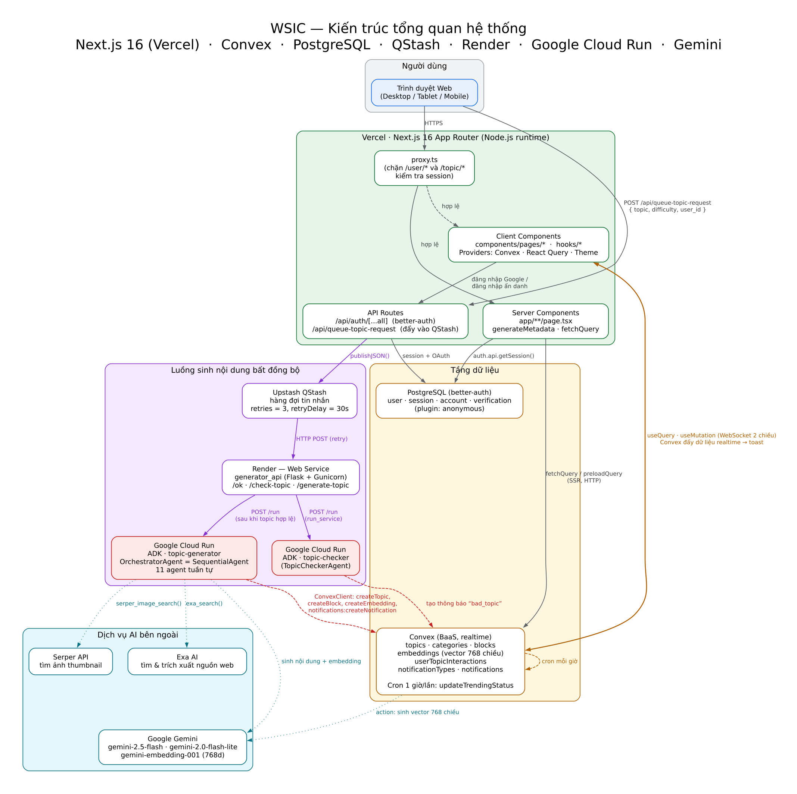
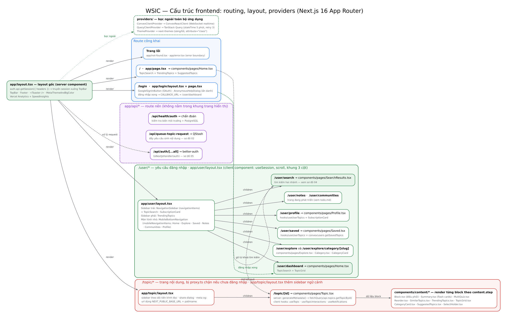
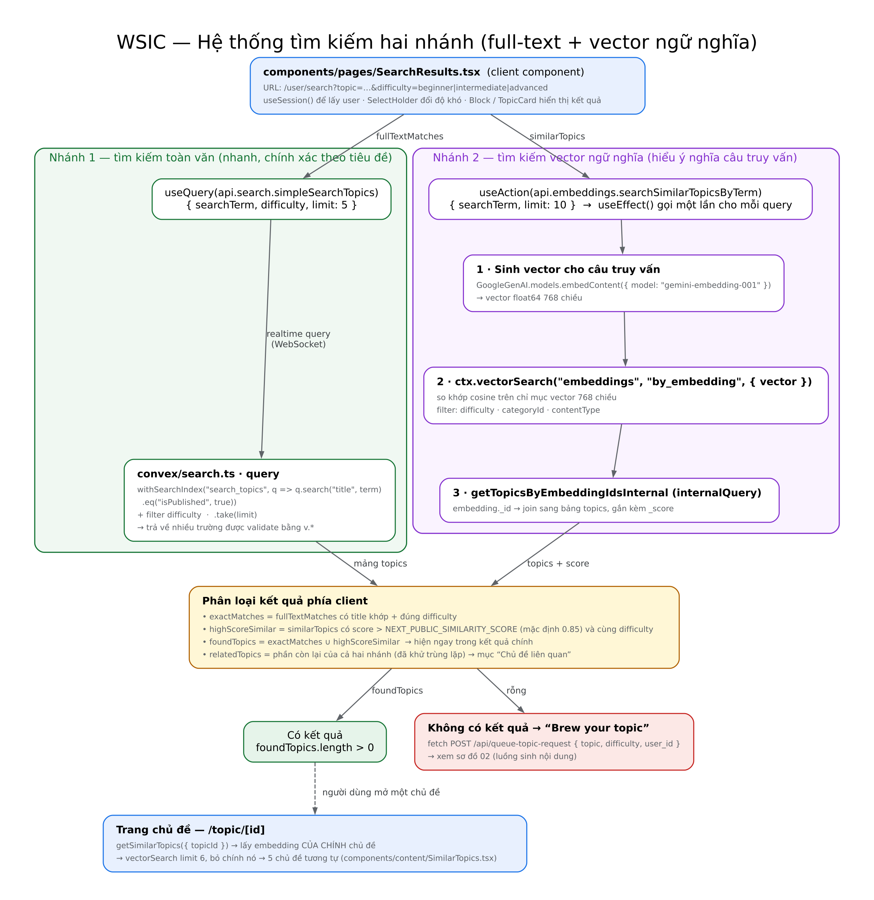
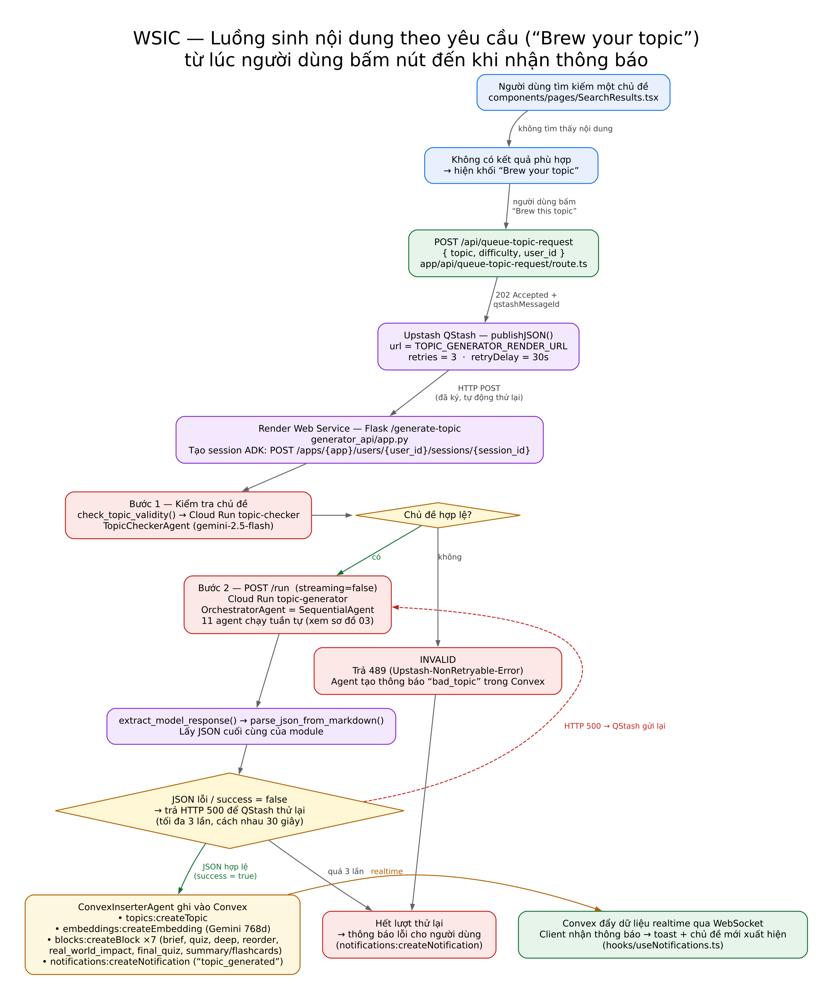
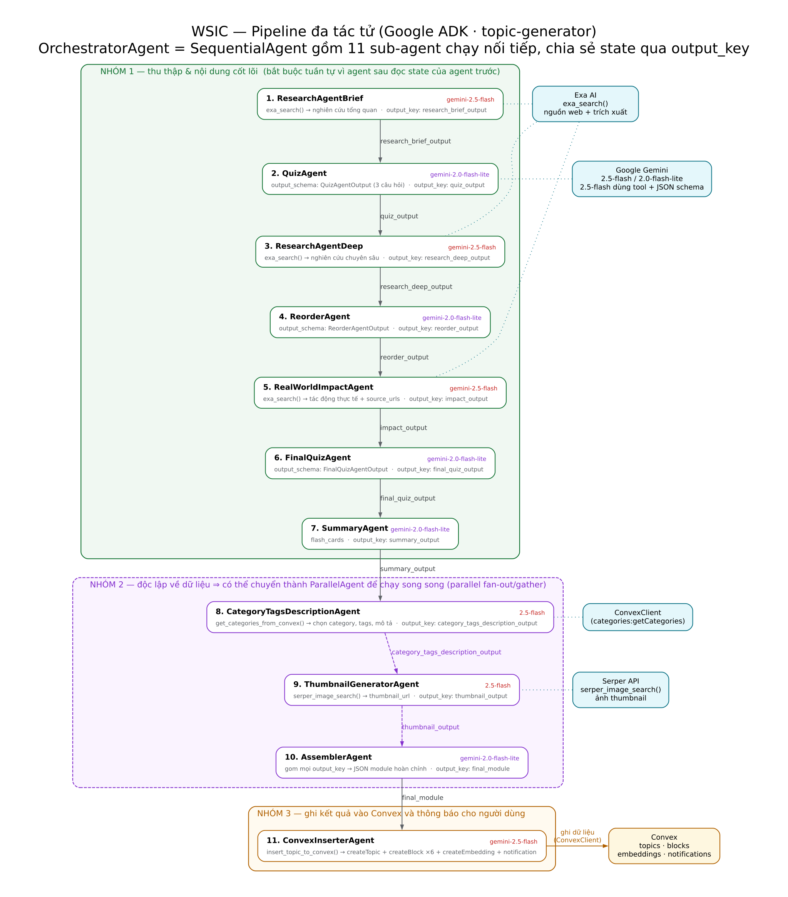
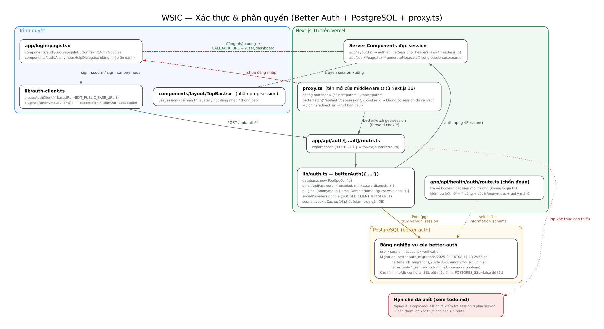
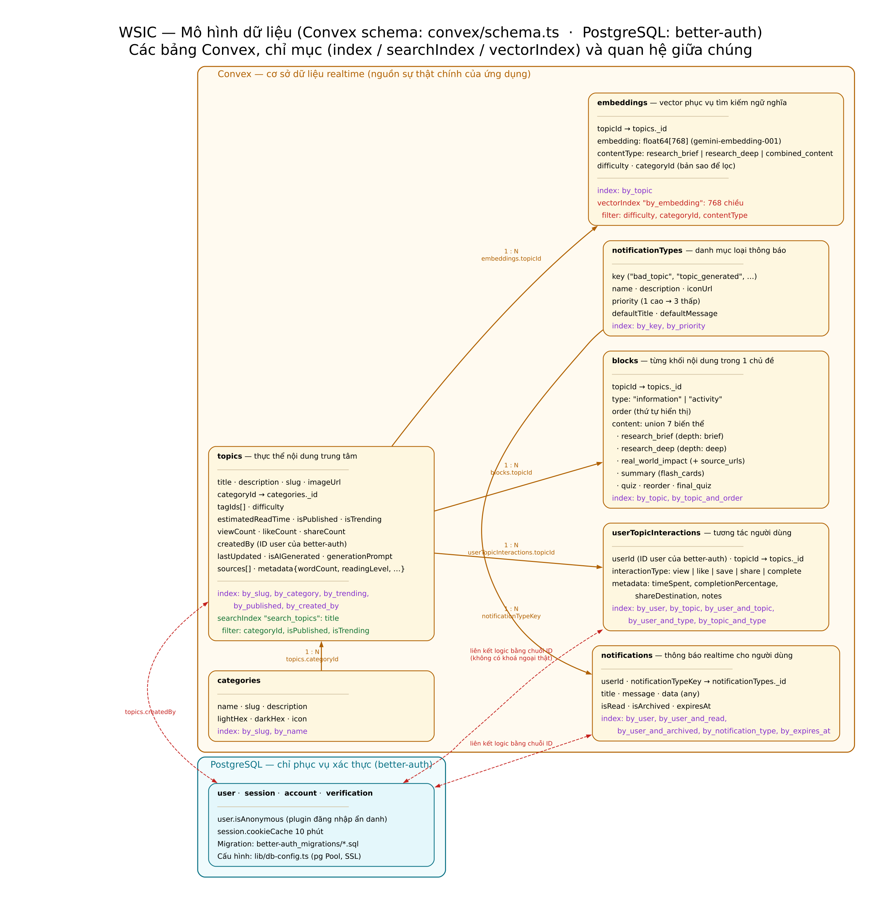

# Kiến trúc WSIC (Why Should I Care)

> Tài liệu này mô tả kiến trúc thực tế của mã nguồn tại thời điểm viết, **được đối chiếu trực tiếp với code** (không sao chép lại các mô tả cũ trong `README.md`/`docs/` khi chúng đã lệch).
> Toàn bộ sơ đồ nằm trong [`docs/diagrams/`](./diagrams/) (PNG + SVG + mã nguồn Graphviz).

## 1. Tóm tắt trong 30 giây

WSIC là một ứng dụng học tập: người dùng tìm một chủ đề, nếu chủ đề **chưa có** trong cơ sở dữ liệu thì hệ thống sẽ “brew” (ủ) ra một **module học tập hoàn chỉnh** bằng pipeline đa tác tử AI (Google ADK + Gemini), rồi lưu vào Convex và thông báo realtime cho người dùng.

| Lớp | Công nghệ | Vai trò |
| --- | --- | --- |
| Giao diện | Next.js 16 (App Router) + React 19 + TypeScript + Tailwind CSS 4 + Radix/shadcn | Render trang, tìm kiếm, hiển thị module, thông báo realtime |
| API nội bộ | Route Handlers trong `app/api/*` | better-auth handler, đẩy yêu cầu sinh nội dung vào QStash, health check |
| Dữ liệu chính | **Convex** (BaaS, realtime, vector search 768 chiều) | `topics`, `categories`, `blocks`, `embeddings`, `userTopicInteractions`, `notifications` |
| Dữ liệu xác thực | **PostgreSQL** (thư viện `pg`) | Bảng `user`, `session`, `account`, `verification` của better-auth |
| Hàng đợi | **Upstash QStash** | Giao việc sinh nội dung, tự động thử lại 3 lần, cách nhau 30 giây |
| Điều phối sinh nội dung | **Render** — `generator_api` (Flask + Gunicorn) | Kiểm tra chủ đề, gọi các agent, parse JSON, chống trùng |
| Tác tử AI | **Google Cloud Run** — ADK (`agents/topic-checker`, `agents/topic-generator`) | 1 agent kiểm duyệt + 11 sub-agent sinh nội dung |
| Dịch vụ AI ngoài | Gemini (`2.5-flash`, `2.0-flash-lite`, `gemini-embedding-001`), Exa AI, Serper | Sinh nội dung, embedding, nghiên cứu web, tìm ảnh thumbnail |
| Triển khai | Vercel (web) + Render (worker Flask) + Cloud Run (agent) + Convex Cloud | `vercel.json` chạy `convex deploy` trong mỗi lần build |

---

## 2. Sơ đồ 1 — Kiến trúc tổng quan



*(Bản vector xem rõ hơn: [`01-tong-quan.svg`](./diagrams/01-tong-quan.svg) · nguồn: [`src/01-tong-quan.dot`](./diagrams/src/01-tong-quan.dot))*

Các luồng chính:

1. **Đọc nội dung (đồng bộ):** Trình duyệt → `proxy.ts` (kiểm tra session) → Server/Client Component → **Convex** qua `fetchQuery` (SSR) hoặc `useQuery`/`useMutation` (WebSocket realtime).
2. **Ghi tương tác:** `hooks/useTopicInteractions` → mutation `users.recordInteraction` → `internal.topics.updateTopicMetrics` (tăng `viewCount`/`likeCount`/`shareCount`).
3. **Sinh nội dung (bất đồng bộ):** Trình duyệt → `/api/queue-topic-request` → **QStash** → **Render (Flask)** → **Cloud Run (ADK agents)** → ghi **Convex** → Convex đẩy dữ liệu realtime trở lại trình duyệt (`toast` + chủ đề mới xuất hiện).
4. **Vector hoá:** Convex action `embeddings.*` và agent gọi **Gemini** để sinh vector 768 chiều; `convex/crons.ts` chạy mỗi giờ để cập nhật cờ `isTrending`.

---

## 3. Sơ đồ 7 — Frontend: route, layout, providers



*(Vector: [`07-frontend.svg`](./diagrams/07-frontend.svg) · nguồn: [`src/07-frontend.dot`](./diagrams/src/07-frontend.dot))*

### 3.1. Cây route (`app/`)

| Route | Tệp | Component chính | Ghi chú |
| --- | --- | --- | --- |
| `/` | `app/page.tsx` | `components/pages/Home.tsx` | Server component: đã đăng nhập thì `redirect(CALLBACK_URL)` về dashboard; chưa đăng nhập thấy trang chủ |
| `/login` | `app/login/layout.tsx`, `app/login/page.tsx` | `GoogleSignInButton`, `AnonymousHelpDialog` | Đăng nhập Google OAuth **hoặc** ẩn danh (plugin `anonymous`) |
| `/user/dashboard` | `app/user/dashboard/page.tsx` | `TopicSearch` + `TopicGrid` | `generateMetadata()` dùng `session.user.name` |
| `/user/search` | `app/user/search/page.tsx` | `components/pages/SearchResults.tsx` | Tìm kiếm hai nhánh — xem mục 4 |
| `/user/explore` | `app/user/explore/page.tsx` | `components/pages/Explore.tsx` | Duyệt theo danh mục |
| `/user/explore/category/[slug]` | `app/user/explore/category/[slug]/page.tsx` | `components/pages/Category.tsx` | Danh mục theo slug |
| `/user/saved` | `app/user/saved/page.tsx` | `components/pages/Saved.tsx` | `convex/users.getSavedTopics` |
| `/user/profile` | `app/user/profile/page.tsx` | `components/pages/Profile.tsx` | `useUserTopics` + `SubscriptionCard` |
| `/user/notes`, `/user/communities` | tương ứng | — | Khung trang, tính năng đang phát triển (xem `todo.md`) |
| `/topic/[id]` | `app/topic/layout.tsx`, `app/topic/[id]/page.tsx` | `components/pages/Topic.tsx` | Server: `fetchQuery(api.topics.getTopicById)` cho metadata; Client: `useTopic`, `useTopicInteractions`, `useNotifications` |
| `/api/auth/[...all]` | `app/api/auth/[...all]/route.ts` | `toNextJsHandler(auth)` | Toàn bộ endpoint của better-auth |
| `/api/queue-topic-request` | `app/api/queue-topic-request/route.ts` | — | `QStash.publishJSON()` |
| `/api/health/auth` | `app/api/health/auth/route.ts` | — | Chẩn đoán biến môi trường + kết nối PostgreSQL (chỉ trả boolean/mã lỗi) |

### 3.2. Layout & provider

- `app/layout.tsx` (**server component**): đọc session bằng `auth.api.getSession({ headers })`, bọc toàn bộ ứng dụng trong **3 provider** theo thứ tự `ConvexClientProvider` → `QueryClientProvider` (TanStack Query) → `ThemeProvider` (next-themes), kèm `TopBar`, `Footer`, `<Toaster />` (sonner), Analytics, SpeedInsights.
- `app/user/layout.tsx` (**client component**): điều khiển khung 3 cột (sidebar trái `NavigationSidebar` + `TopicSearch` + `SubscriptionCard`, nội dung giữa, sidebar phải `TrendingTopics`) và **tự tính lại chiều cao sidebar theo hướng cuộn** (`TOPBAR_SCROLL_THRESHOLD`); trên màn hình nhỏ hiển thị `MobileBottomNavigation`.
- `app/topic/layout.tsx`: thêm sidebar theo dõi tiến trình đọc chủ đề, `share-dialog`, và thẻ `og:` dùng `NEXT_PUBLIC_BASE_URL` + `pathname`.

---

## 4. Sơ đồ 4 — Hệ thống tìm kiếm hai nhánh



*(Vector: [`04-tim-kiem.svg`](./diagrams/04-tim-kiem.svg) · nguồn: [`src/04-tim-kiem.dot`](./diagrams/src/04-tim-kiem.dot))*

`components/pages/SearchResults.tsx` chạy **song song hai nhánh** với cùng một `topic` lấy từ query string:

| Nhánh | Truy vấn | Cài đặt |
| --- | --- | --- |
| **Full-text** | `useQuery(api.search.simpleSearchTopics, { searchTerm, difficulty, limit: 5 })` | `convex/search.ts` dùng `withSearchIndex("search_topics", q => q.search("title", term).eq("isPublished", true))`, lọc thêm theo `difficulty`, `.take(limit)` |
| **Vector ngữ nghĩa** | `useAction(api.embeddings.searchSimilarTopicsByTerm, { searchTerm, limit: 10 })` | `convex/embeddings.ts`: (1) sinh embedding 768 chiều cho câu truy vấn bằng Gemini `gemini-embedding-001`; (2) `ctx.vectorSearch("embeddings", "by_embedding", { vector })`; (3) join ngược sang `topics` qua `internal.embeddings.getTopicsByEmbeddingIdsInternal`, giữ lại `_score` |

Sau đó client phân loại:

- `exactMatches` – kết quả full-text có **tiêu đề khớp** và đúng độ khó;
- `highScoreSimilar` – kết quả vector có `score > NEXT_PUBLIC_SIMILARITY_SCORE` (mặc định **0.85**) và cùng độ khó;
- `foundTopics = exactMatches ∪ highScoreSimilar` → hiển thị ở khu kết quả chính;
- phần còn lại của cả hai nhánh (đã khử trùng lặp) → mục **“Chủ đề liên quan”**;
- `foundTopics` rỗng → hiện khối **“Brew your topic”** (chuyển sang sơ đồ 2).

Trên trang chủ đề, `SimilarTopics.tsx` dùng `api.embeddings.getSimilarTopics({ topicId })`: lấy embedding **của chính chủ đề**, `vectorSearch` `limit: 6`, bỏ chính nó → **5 chủ đề tương tự**.

---

## 5. Sơ đồ 2 — Luồng sinh nội dung theo yêu cầu (“Brew your topic”)



*(Vector: [`02-luong-sinh-noi-dung.svg`](./diagrams/02-luong-sinh-noi-dung.svg) · nguồn: [`src/02-luong-sinh-noi-dung.dot`](./diagrams/src/02-luong-sinh-noi-dung.dot))*

| Bước | Ở đâu | Việc gì |
| --- | --- | --- |
| 1 | `SearchResults.tsx` | Người dùng bấm “Brew this topic” → `fetch POST /api/queue-topic-request { topic, difficulty, user_id }` |
| 2 | `app/api/queue-topic-request/route.ts` | `QStash.publishJSON({ url: TOPIC_GENERATOR_RENDER_URL, body, retries: 3, retryDelay: "30000" })` → trả `qstashMessageId` |
| 3 | `generator_api/app.py` (`/generate-topic`) | Tạo session ADK (`POST /apps/{app}/users/{user_id}/sessions/{session_id}`) rồi gọi agent bằng `POST /run` (`streaming: false`) |
| 4 | Cloud Run `topic-checker` | `TopicCheckerAgent` trả về `{ status: "VALID" \| "INVALID", reason }`; nếu INVALID thì agent tự tạo thông báo `bad_topic` trong Convex |
| 5 | Cloud Run `topic-generator` | Chạy `OrchestratorAgent` (11 sub-agent, xem sơ đồ 3) |
| 6 | `generator_api/app.py` | `extract_model_response()` lấy phần text cuối của model, `parse_json_from_markdown()` bóc JSON khỏi code fence |
| 7 | `ConvexInserterAgent` | Ghi `topics:createTopic` → `embeddings:createEmbedding` → `blocks:createBlock` ×7 → `notifications:createNotification` (`topic_generated`) |
| 8 | Trình duyệt | Convex đẩy dữ liệu realtime → `hooks/useNotifications.ts` hiện toast, chủ đề mới xuất hiện trong dashboard |

Quy ước lỗi / thử lại:

- Lỗi **không thể thử lại** (thiếu `topic`/`user_id`, chủ đề INVALID): trả **HTTP 489** kèm header `Upstash-NonRetryable-Error: true`.
- Lỗi tạm thời (model trả JSON sai, `success = false`): trả **HTTP 500** để QStash thử lại (3 lần, cách 30 giây) — hết lượt thì tạo thông báo lỗi.
- ⚠️ **Điểm yếu đã biết** (ghi chú `TODO` ngay trong `app.py`): đôi khi nội dung đã sinh thành công nhưng endpoint vẫn trả về non-200, khiến QStash thử lại và **sinh trùng chủ đề**. Hướng khắc phục đã có trong `todo.md`: thêm bảng `topic_generation_requests` (khoá theo `qstash_message_id`) làm nguồn sự thật cho trạng thái `in-progress / success / error`.

---

## 6. Sơ đồ 3 — Pipeline đa tác tử (Google ADK)



*(Vector: [`03-multi-agent.svg`](./diagrams/03-multi-agent.svg) · nguồn: [`src/03-multi-agent.dot`](./diagrams/src/03-multi-agent.dot))*

`agents/topic-generator/agent.py` định nghĩa `orchestrator_agent = SequentialAgent(sub_agents=[...])` gồm **11 sub-agent** chạy tuần tự; các agent trao đổi dữ liệu qua **`output_key`** (state dùng chung của ADK), phần lớn prompt yêu cầu **chỉ trả JSON thuần, không bọc code fence**.

| # | Agent | Model | Công cụ / `output_schema` | `output_key` |
| --- | --- | --- | --- | --- |
| 1 | `ResearchAgentBrief` | gemini-2.5-flash | `exa_search()` | `research_brief_output` |
| 2 | `QuizAgent` | gemini-2.0-flash-lite | `QuizAgentOutput` (3 câu hỏi trắc nghiệm) | `quiz_output` |
| 3 | `ResearchAgentDeep` | gemini-2.5-flash | `exa_search()` | `research_deep_output` |
| 4 | `ReorderAgent` | gemini-2.0-flash-lite | `ReorderAgentOutput` | `reorder_output` |
| 5 | `RealWorldImpactAgent` | gemini-2.5-flash | `exa_search()` | `impact_output` |
| 6 | `FinalQuizAgent` | gemini-2.0-flash-lite | `FinalQuizAgentOutput` | `final_quiz_output` |
| 7 | `SummaryAgent` | gemini-2.0-flash-lite | `SummaryAgentOutput` (flash cards) | `summary_output` |
| 8 | `CategoryTagsDescriptionAgent` | gemini-2.5-flash | `get_categories_from_convex()` | `category_tags_description_output` |
| 9 | `ThumbnailGeneratorAgent` | gemini-2.5-flash | `serper_image_search()` | `thumbnail_output` |
| 10 | `AssemblerAgent` | gemini-2.0-flash-lite | `FinalAssemblyOutput` | `final_module` |
| 11 | `ConvexInserterAgent` | gemini-2.5-flash | `insert_topic_to_convex()` | `insertion_result` |

**Đầu ra của `AssemblerAgent`** (`final_module`): `topic`, `difficulty`, `created_by`, `publish_immediately`, `research_brief`, `research_deep`, `quiz`, `reorder`, `final_quiz`, `real_world_impact`, `flash_cards`, `thumbnail`, `category_tags_description`.

**`ConvexInserterAgent` ghi gì vào Convex?**

- `topics:createTopic` — `title`, `description` (lấy từ `short_description`), `slug` (`create_slug`), `difficulty`, `estimatedReadTime` (`estimate_read_time`), `isAIGenerated: true`, `generationPrompt`, `sources`, `imageUrl`, `categoryId`, `tagIds` (`process_tags`), `createdBy`, và `metadata { wordCount, readingLevel, estimatedTime, exerciseCount }`.
- `embeddings:createEmbedding` — vector 768 chiều sinh từ **toàn văn `research_brief`**, `contentType: "research_brief"`.
- `blocks:createBlock` — 7 block theo thứ tự: `research_brief` (information) → `quiz` (activity) → `research_deep` → `reorder` → `real_world_impact` → `final_quiz` → `summary` (flash cards).
- `notifications:createNotification` — thông báo `topic_generated` (thành công) hoặc thông báo lỗi; agent kiểm duyệt tạo thông báo `bad_topic`.

`agents/topic-checker/agent.py` chỉ có một `TopicCheckerAgent` (gemini-2.5-flash) với `output_schema=TopicValidationOutput{ status, reason }` và công cụ `create_bad_topic_notification()`.

> **Lưu ý về tài liệu cũ:** `docs/topic-generation.md` và `README.md` mô tả “8 agent”, có “Validator Agent (fact-check bằng Google Search)” và “Interactive Content Agent” dùng chung. Trong mã nguồn hiện tại **không còn** hai agent đó: có **11 sub-agent** như bảng trên, việc tổng hợp do `AssemblerAgent` làm, và bước “kiểm chứng” thực chất là công cụ `exa_search()` trong các agent nghiên cứu.

---

## 7. Sơ đồ 5 — Xác thực & phân quyền



*(Vector: [`05-xac-thuc.svg`](./diagrams/05-xac-thuc.svg) · nguồn: [`src/05-xac-thuc.dot`](./diagrams/src/05-xac-thuc.dot))*

- **Cấu hình** (`lib/auth.ts`): `betterAuth({ database: new Pool(pgConfig) })` với `emailAndPassword` (tối thiểu 8 ký tự), `plugins: [anonymous({ emailDomainName: "guest.wsic.app" })]`, `socialProviders.google`, và `session.cookieCache` 10 phút để giảm truy vấn PostgreSQL.
- **Kết nối DB** (`lib/db-config.ts`): `pg.Pool` đọc `POSTGRES_*`; SSL bật mặc định, tắt bằng `POSTGRES_SSL=false`.
- **Client** (`lib/auth-client.ts`): `createAuthClient({ baseURL: NEXT_PUBLIC_BASE_URL, plugins: [anonymousClient()] })` → `signIn`, `signOut`, `useSession`; `useSession()` được `TopBar` dùng để hiển thị avatar / nút đăng nhập / huy hiệu thông báo.
- **Chặn truy cập** (`proxy.ts`): từ Next.js 16, `middleware.ts` được đổi tên thành `proxy.ts` (chạy trên Node.js runtime). Matcher `["/user/:path*", "/topic/:path*"]`; hàm gọi `betterFetch("/api/auth/get-session", { baseURL, headers: { cookie } })`, không có session thì `redirect("/login?redirect_url=...")`.
- **Chẩn đoán** (`app/api/health/auth/route.ts`): chỉ trả về boolean các biến môi trường + trạng thái kết nối + sự tồn tại của 4 bảng và cột `isAnonymous`, kèm gợi ý theo mã lỗi PostgreSQL.
- **Migration**: `better-auth_migrations/2025-08-16T08-17-13.295Z.sql` (bảng cơ bản) và `better-auth_migrations/2026-10-07-anonymous-plugin.sql` (`alter table "user" add column if not exists "isAnonymous" boolean`).
- ⚠️ **Khoảng trống bảo mật đã biết**: `/api/queue-topic-request` **không kiểm tra session phía server** (chỉ dựa vào việc UI gửi `user_id`) — nằm trong danh sách `todo.md` (“Add authentication to API routes”).

---

## 8. Sơ đồ 6 — Mô hình dữ liệu



*(Vector: [`06-mo-hinh-du-lieu.svg`](./diagrams/06-mo-hinh-du-lieu.svg) · nguồn: [`src/06-mo-hinh-du-lieu.dot`](./diagrams/src/06-mo-hinh-du-lieu.dot))*

### 8.1. Convex (`convex/schema.ts`)

| Bảng | Trường chính | Chỉ mục |
| --- | --- | --- |
| `categories` | `name`, `slug`, `description`, `lightHex`, `darkHex`, `icon` | `by_slug`, `by_name` |
| `topics` | `title`, `description`, `slug`, `categoryId`, `tagIds[]`, `imageUrl`, `difficulty`, `estimatedReadTime`, `isPublished`, `isTrending`, `viewCount`, `likeCount`, `shareCount`, `createdBy`, `lastUpdated`, `isAIGenerated`, `generationPrompt`, `sources[]`, `metadata` | `by_slug`, `by_category`, `by_trending`, `by_published`, `by_created_by`, **searchIndex `search_topics`** (trường `title`, lọc theo `categoryId`, `isPublished`, `isTrending`) |
| `embeddings` | `topicId`, `embedding: float64[]`, `contentType`, `difficulty`, `categoryId` | `by_topic`, **vectorIndex `by_embedding`** (768 chiều, lọc theo `difficulty`, `categoryId`, `contentType`) |
| `blocks` | `topicId`, `type` (`information` \| `activity`), `order`, `content` (union 7 biến thể) | `by_topic`, `by_topic_and_order` |
| `userTopicInteractions` | `userId`, `topicId`, `interactionType` (`view`/`like`/`save`/`share`/`complete`), `metadata` | `by_user`, `by_topic`, `by_user_and_topic`, `by_user_and_type`, `by_topic_and_type` |
| `notificationTypes` | `key`, `name`, `description`, `iconUrl`, `priority`, `defaultTitle`, `defaultMessage` | `by_key`, `by_priority` |
| `notifications` | `userId`, `notificationTypeKey`, `title`, `message`, `isRead`, `isArchived`, `data`, `expiresAt` | `by_user`, `by_user_and_read`, `by_user_and_archived`, `by_notification_type`, `by_expires_at` |

`blocks.content` là **union 7 biến thể** định nghĩa ngay trong `schema.ts` — “một nguồn sự thật” dùng chung cho cả Convex lẫn agent Python: `research_brief`, `research_deep`, `real_world_impact`, `summary` (flash cards), `quiz`, `reorder`, `final_quiz`.

### 8.2. Quan hệ giữa hai cơ sở dữ liệu

`topics.createdBy`, `userTopicInteractions.userId`, `notifications.userId` lưu **ID người dùng của better-auth dưới dạng chuỗi** — đây là **liên kết logic, không có khoá ngoại thật** giữa Convex và PostgreSQL. Vì vậy, dữ liệu người dùng ở Convex không tự động bị xoá/dọn khi bản ghi bên PostgreSQL thay đổi.

### 8.3. Công thức “trending”

`convex/crons.ts` chạy `internal.topics.updateTrendingStatus` **mỗi giờ**:

```text
recentEngagement = views(24h)·1 + likes(24h)·5 + shares(24h)·10
totalEngagement  = viewCount·0.5 + likeCount·2 + shareCount·5
ageFactor        = max(0.1, 1 − số_ngày_tuổi / 30)          // giảm dần trong 30 ngày
trendingScore    = (recentEngagement·10 + totalEngagement·2) · ageFactor
```

Top **20 %** bài viết (tối thiểu 1, tối đa 50) có `trendingScore ≥ ngưỡng` được đặt `isTrending = true`. Ngoài cron, mutation `topics.triggerTrendingUpdate` cho phép cập nhật thủ công (đang được `hooks/useTrendingTopics.ts` dùng).

---

## 9. Bảng tra cứu thành phần

| Nhóm | Tệp tiêu biểu | Trách nhiệm |
| --- | --- | --- |
| Route/layout | `app/**/*.tsx` | Định tuyến App Router, metadata, khung trang |
| Trang (client) | `components/pages/*` | `Home`, `SearchResults`, `Topic`, `Explore`, `Category`, `Saved`, `Profile` |
| Khối nội dung | `components/content/*` | `Block` (điều phối theo `content.step`), `MultiQuiz`, `Reorder`, `Summary` (flash cards), `SimilarTopics`, `SuggestedTopics`, `TrendingTopics`, `TopicGrid`, `CategoryCard`, `SelectHolder` |
| Layout & điều hướng | `components/layout/*`, `components/navigation/*` | `TopBar`, `Footer`, `Notification`, `ThemeToggle`, `MetaThemeAndBgColor`, `NavigationSidebar`, `MobileBottomNavigation` |
| Tính năng | `components/features/*` | `TopicSearch`, `SubscriptionCard` |
| Xác thực | `components/auth/*`, `lib/auth.ts`, `lib/auth-client.ts`, `proxy.ts` | Đăng nhập Google/ẩn danh, chặn route |
| Hooks | `hooks/*` | `useTopics`, `useTopic`, `useTrendingTopics`, `useUserTopics`, `useTopicInteractions`, `useNotifications`, `useTopBarVisibility` |
| Convex | `convex/topics.ts`, `search.ts`, `embeddings.ts`, `blocks.ts`, `categories.ts`, `users.ts`, `notifications.ts`, `constants.ts`, `seed.ts`, `crons.ts` | Truy vấn/mutation/action, chỉ mục, cron |
| Provider | `providers/*` | Convex client, TanStack Query, theme |
| Tiện ích | `lib/utils.ts`, `lib/format.ts`, `lib/share.ts`, `lib/db-config.ts` | `cn()`, định dạng, chia sẻ (Web Share / clipboard / mạng xã hội), cấu hình `pg.Pool` |
| Hằng số | `constants/common.ts` | Tên ứng dụng, `CALLBACK_URL`, `TOPBAR_SCROLL_THRESHOLD`, cấu hình điều hướng, bảng màu độ khó |

---

## 10. Biến môi trường

| Biến | Nơi dùng | Ý nghĩa |
| --- | --- | --- |
| `NEXT_PUBLIC_CONVEX_URL` | `providers/ConvexClientProvider.tsx`, `vercel.json` | URL deployment Convex (được vá tự động khi `convex deploy`) |
| `NEXT_PUBLIC_BASE_URL` | `lib/auth-client.ts`, `app/topic/layout.tsx`, `components/content/Block.tsx` | URL công khai của ứng dụng (OAuth callback, thẻ `og:`, link chia sẻ) |
| `NEXT_PUBLIC_SIMILARITY_SCORE` | `components/pages/SearchResults.tsx` | Ngưỡng điểm tương đồng để xếp vào kết quả chính (mặc định `0.85`) |
| `NEXT_PUBLIC_SUCCESS_NOTIFICATION_KEY` | `hooks/useNotifications.ts` | Khoá loại thông báo “sinh thành công” |
| `POSTGRES_HOST/PORT/DATABASE/USER/PASSWORD` | `lib/db-config.ts` | Kết nối PostgreSQL cho better-auth |
| `POSTGRES_SSL` | `lib/db-config.ts` | `false` để tắt SSL |
| `BETTER_AUTH_SECRET`, `BETTER_AUTH_URL` | better-auth | Bí mật & URL gốc của dịch vụ xác thực |
| `GOOGLE_CLIENT_ID`, `GOOGLE_CLIENT_SECRET` | `lib/auth.ts` | OAuth Google |
| `GOOGLE_API_KEY` | Convex actions / agent | Gọi Gemini (embedding & sinh nội dung) |
| `QSTASH_TOKEN` | `app/api/queue-topic-request/route.ts` | Gửi tin nhắn vào QStash |
| `TOPIC_GENERATOR_RENDER_URL` | `app/api/queue-topic-request/route.ts` | Đích QStash gọi (dịch vụ Flask trên Render) |
| `TOPIC_CHECKER_BASE_URL`, `TOPIC_GENERATOR_BASE_URL` | `generator_api/app.py` | URL các agent ADK trên Cloud Run |
| `CONVEX_URL` | `generator_api/app.py`, `agents/**` | URL Convex mà worker/agent ghi vào |
| `EXA_API_KEY`, `EXA_NUM_RESULTS`, `SERPER_API_KEY` | `agents/topic-generator/agent.py` | Nghiên cứu web (Exa) và tìm ảnh thumbnail (Serper) |

---

## 11. Triển khai

| Thành phần | Nền tảng | Cách chạy |
| --- | --- | --- |
| Web (Next.js) | **Vercel** | `vercel.json`: `npx convex deploy --cmd-url-env-var-name NEXT_PUBLIC_CONVEX_URL --cmd 'npm run build'` → mỗi lần build vừa deploy schema/hàm Convex vừa build Next.js |
| Worker sinh nội dung | **Render** | `generator_api/app.py` qua `gunicorn` (deps: `Flask`, `Gunicorn`, `requests`, `python-dotenv`, `convex`) |
| Tác tử ADK | **Google Cloud Run** | `agents/topic-checker`, `agents/topic-generator` (`google-adk`, `google-genai`, `pydantic`, `exa-py`, `convex`) |
| Hàng đợi | **Upstash QStash** | Gọi HTTP tới `TOPIC_GENERATOR_RENDER_URL`, thử lại 3 lần |
| CSDL | **Convex Cloud** + PostgreSQL (Neon/Supabase…) | Schema đồng bộ bằng `convex deploy`; migration SQL chạy tay |

Phát triển cục bộ: `npm run dev` (Next.js) — đồng thời cần `npx convex dev` cho schema/functions và một PostgreSQL cho xác thực.

---

## 12. Ghi chú & nợ kỹ thuật

Điểm **đã lệch so với tài liệu cũ** (nên cập nhật khi có thời gian):

1. `README.md` nói “Next.js 15.4.6 / React 19.1.0”, nhưng `package.json` là **Next.js 16** và **React 19.2**; `middleware.ts` đã được đổi tên thành **`proxy.ts`** và các tài liệu cũ vẫn nhắc `middleware.ts`.
2. `docs/topic-generation.md` mô tả **8 agent** (có Validator/Thumbnail/Assembler khác), mã nguồn thực tế có **11 sub-agent** và không có Validator Agent dùng Google Search.
3. `docs/project-structure.md` thiếu các thư mục đã tồn tại: `hooks/`, `providers/`, `interfaces/`, `constants/`, `better-auth_migrations/`, `docs/diagrams/`.

Việc nên làm tiếp (trích `todo.md`):

- Thêm xác thực cho **mọi** API route (hiện `/api/queue-topic-request` không kiểm tra session).
- Thêm bảng `topic_generation_requests` để **khử sinh trùng** và hiển thị tiến trình sinh nội dung trên TopBar.
- Rate limit theo người dùng (Upstash Redis) và gói trả phí (Polar).
- Đổi mô hình embedding sang `text-embedding-3-large` + script tạo lại toàn bộ embedding.
- Tối ưu: `ParallelAgent` cho các agent độc lập (nhóm 2 trong sơ đồ 3), callback ADK để làm sạch output, chuyển `generator_api` từ Render sang Azure Functions để giảm chi phí.

---

*Sơ đồ được tạo bằng Graphviz; xem [`docs/diagrams/README.md`](./diagrams/README.md) để biết cách vẽ lại.*
