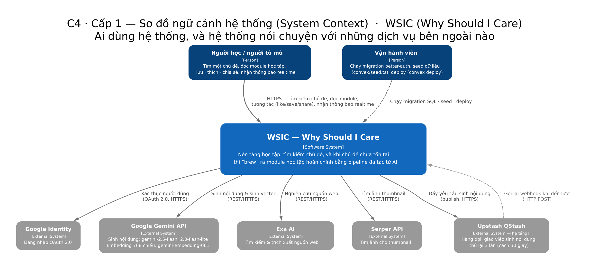
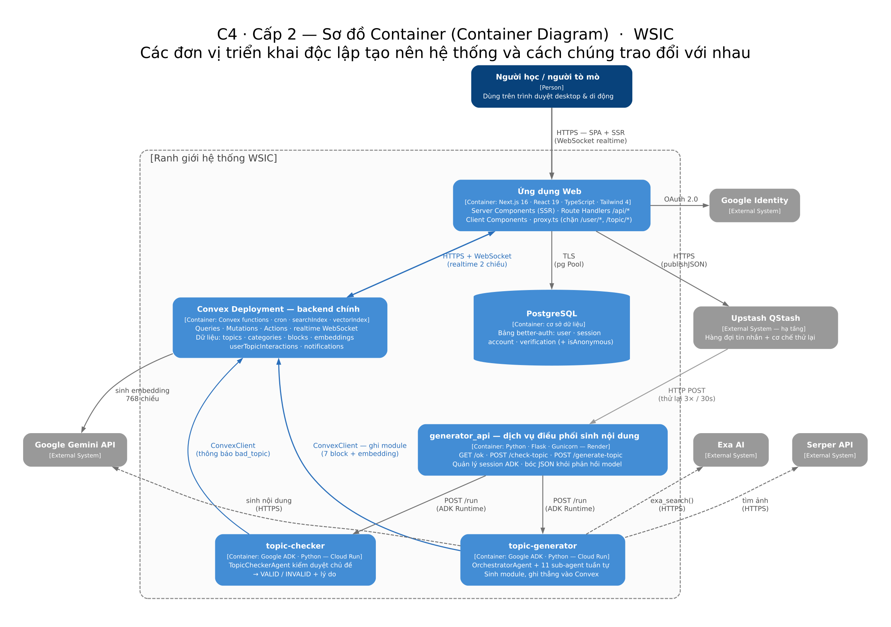
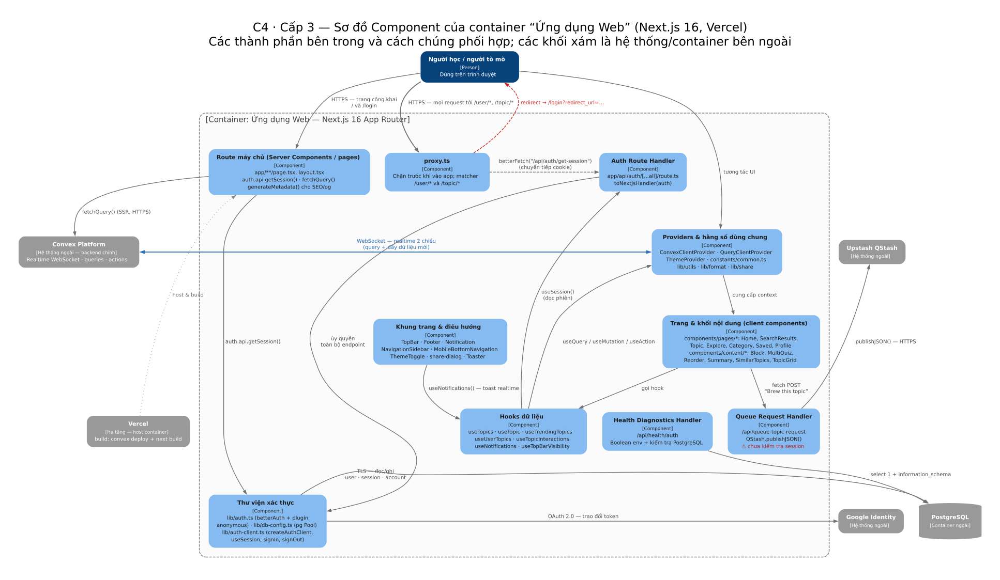
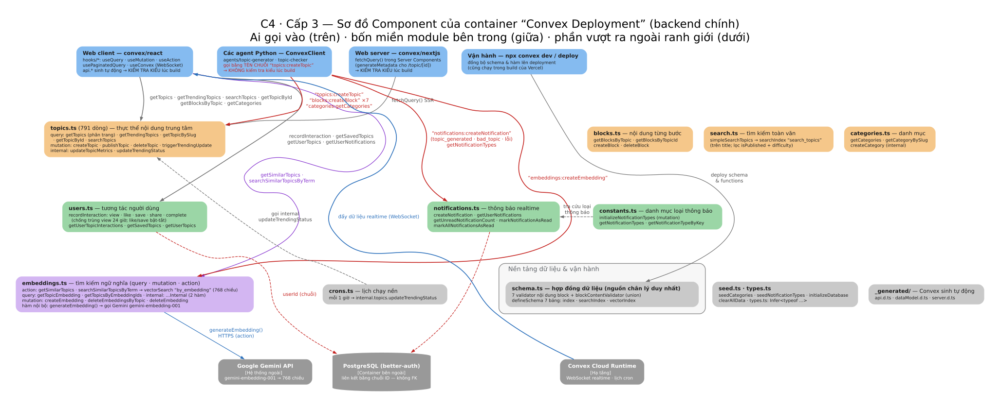
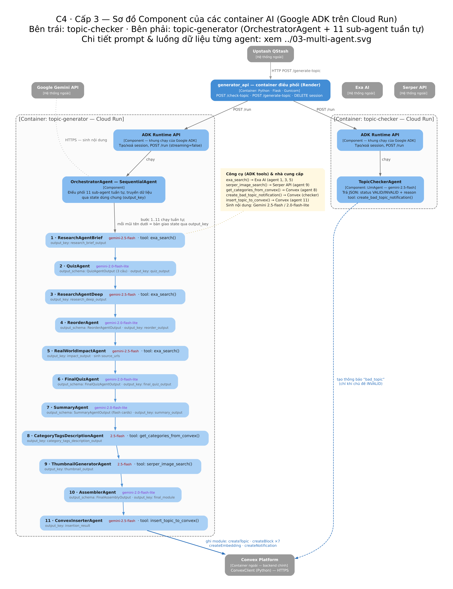
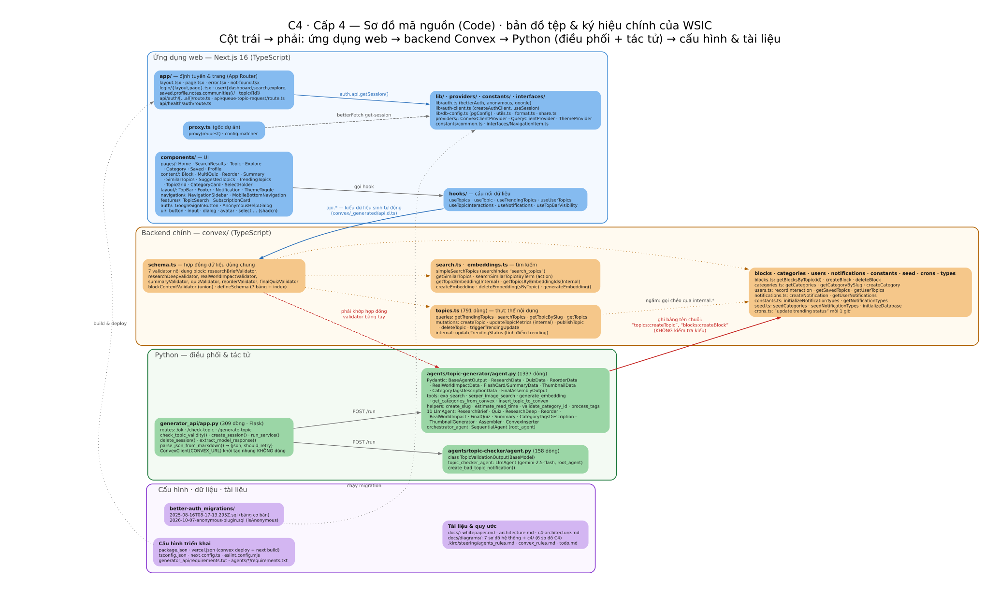

# WSIC — Kiến trúc theo mô hình C4

Bộ sơ đồ này diễn giải hệ thống WSIC theo **mô hình C4** (Simon Brown): bốn cấp độ trừu tượng giảm dần — *Context → Container → Component → Code* — mỗi cấp trả lời một câu hỏi khác nhau và dành cho một nhóm người đọc khác nhau.

> Bản mô tả kiến trúc đầy đủ (tiếng Việt, kèm 7 sơ đồ luồng): [`architecture.md`](./architecture.md).
> Bản phân tích thiết kế & định hướng: [`whitepaper.md`](./whitepaper.md).

| Cấp | Câu hỏi mà sơ đồ trả lời | Người đọc | Tệp |
| --- | --- | --- | --- |
| **1 · Context** | Hệ thống là gì, ai dùng, nói chuyện với dịch vụ ngoài nào? | Mọi người, kể cả người không kỹ thuật | [`c4-1-context.png`](./diagrams/c4/c4-1-context.png) · [svg](./diagrams/c4/c4-1-context.svg) · [dot](./diagrams/c4/src/c4-1-context.dot) |
| **2 · Container** | Có những đơn vị triển khai nào, chúng trao đổi ra sao? | Kiến trúc sư, kỹ sư, DevOps | [`c4-2-container.png`](./diagrams/c4/c4-2-container.png) · [svg](./diagrams/c4/c4-2-container.svg) · [dot](./diagrams/c4/src/c4-2-container.dot) |
| **3 · Component** | Bên trong mỗi container có thành phần nào? | Lập trình viên | [Ứng dụng Web](./diagrams/c4/c4-3-components-web.png) · [Convex](./diagrams/c4/c4-3-components-convex.png) · [các container AI](./diagrams/c4/c4-3-components-agents.png) |
| **4 · Code** | Tệp/ký hiệu cụ thể nào đảm nhiệm việc gì? | Lập trình viên mới, người bảo trì | [`c4-4-code.png`](./diagrams/c4/c4-4-code.png) · [svg](./diagrams/c4/c4-4-code.svg) · [dot](./diagrams/c4/src/c4-4-code.dot) |

Quy ước màu dùng chung: 🔵 xanh đậm = con người · 🔵 xanh dương = container/component **của WSIC** · ⬜ xám = hệ thống/hạ tầng **bên ngoài** · 🟠/🟢/🟣 = ranh giới miền nghiệp vụ ở các sơ đồ cấp 3–4.

---

## Cấp 1 — Sơ đồ ngữ cảnh hệ thống



WSIC là **một hệ thống phần mềm** duy nhất (dù triển khai trên 4 nền tảng), phục vụ:

| Tác nhân | Mục tiêu |
| --- | --- |
| **Người học / người tò mò** *(Person)* | Tìm một chủ đề; nếu chưa có thì “brew” ra module học tập; đọc nội dung tương tác (quiz, reorder, flash cards); lưu · thích · chia sẻ; nhận thông báo realtime |
| **Vận hành viên** *(Person)* | Chạy migration better-auth trên PostgreSQL, seed dữ liệu (`convex/seed.ts`), deploy (`convex deploy` trong mỗi lần build Vercel) |

| Hệ thống ngoài | Trao đổi |
| --- | --- |
| **Google Identity** | OAuth 2.0 — đăng nhập |
| **Google Gemini API** | Sinh nội dung (`gemini-2.5-flash`, `gemini-2.0-flash-lite`) và embedding 768 chiều (`gemini-embedding-001`) |
| **Exa AI** | Tìm kiếm & trích xuất nguồn web cho các agent nghiên cứu |
| **Serper API** | Tìm ảnh thumbnail |
| **Upstash QStash** | Hàng đợi: nhận yêu cầu sinh nội dung và **gọi lại webhook** khi đến lượt (thử lại 3 lần, cách 30 giây) |

Điểm đáng chú ý: WSIC **chủ động gọi** 4 dịch vụ (Gemini, Exa, Serper, QStash) nhưng QStash **gọi ngược lại** WSIC qua webhook `/generate-topic` — quan hệ hai chiều, và cũng là lý do container nhận webhook phải là dịch vụ HTTP luôn sẵn sàng (Render), không thể là hàm serverless ngắn hạn trong luồng này.

---

## Cấp 2 — Sơ đồ Container



Sáu container tạo nên hệ thống:

| Container | Công nghệ | Trách nhiệm |
| --- | --- | --- |
| **Ứng dụng Web** | Next.js 16 · React 19 · TypeScript · Tailwind 4 — **Vercel** | Giao diện (Server + Client Components), Route Handlers, chặn truy cập bằng `proxy.ts` |
| **Convex Deployment** | Convex functions (query/mutation/action) + cron + searchIndex + vectorIndex — **Convex Cloud** | Backend chính: dữ liệu chủ đề/block/embedding/tương tác/thông báo, đẩy dữ liệu realtime qua WebSocket |
| **PostgreSQL** | PostgreSQL — dịch vụ bên ngoài | Chỉ phục vụ xác thực: `user` · `session` · `account` · `verification` (better-auth) |
| **generator_api** | Python · Flask · Gunicorn — **Render** | Nhận webhook `/generate-topic`, quản lý session ADK, gọi agent, bóc JSON khỏi phản hồi model, quyết định mã lỗi trả về QStash |
| **topic-checker** | Google ADK — **Cloud Run** | `TopicCheckerAgent` kiểm duyệt chủ đề, trả `VALID`/`INVALID` + lý do |
| **topic-generator** | Google ADK — **Cloud Run** | `OrchestratorAgent` + 11 sub-agent sinh toàn bộ module rồi ghi thẳng vào Convex |

**Vì sao tách container như vậy — các quyết định kiến trúc đọc ra được từ sơ đồ:**

1. **Bất đồng bộ là bắt buộc:** sinh một module mất 3–4 phút; request của trình duyệt không thể giữ lâu như vậy. `/api/queue-topic-request` chỉ `publishJSON()` rồi trả ngay.
2. **Hai nền tảng compute cho hai tính chất tải khác nhau:** Cloud Run phù hợp scale-to-zero cho agent; Render là điểm vào HTTP ổn định, dễ gắn retry/observability.
3. **Hai cơ sở dữ liệu cho hai loại dữ liệu:** Convex giữ thực thể nghiệp vụ + realtime + vector search; PostgreSQL chỉ giữ phiên đăng nhập → **không có khoá ngoại thật** giữa hai bên (`createdBy`, `userId` chỉ là chuỗi ID tham chiếu).
4. **Vòng lặp ghi ngược:** agent tự ghi vào Convex bằng `ConvexClient` (Python) → Convex đẩy dữ liệu realtime về web → người dùng thấy toast. Lớp AI **không cần biết gì về** Next.js.

---

## Cấp 3 — Sơ đồ Component

### 3a. Container “Ứng dụng Web”



| Component | Tệp | Nhiệm vụ & điểm đáng lưu ý |
| --- | --- | --- |
| `proxy.ts` | `proxy.ts` | Chặn `/user/*`, `/topic/*`; gọi `betterFetch("/api/auth/get-session")`, chuyển tiếp cookie |
| Route máy chủ | `app/**/page.tsx`, `layout.tsx` | Server Components đọc phiên (`auth.api.getSession()`), lấy dữ liệu SSR (`fetchQuery`), sinh metadata SEO/og |
| Auth Route Handler | `app/api/auth/[...all]/route.ts` | `toNextJsHandler(auth)` — toàn bộ endpoint better-auth |
| Queue Request Handler | `app/api/queue-topic-request/route.ts` | `QStash.publishJSON()` — ⚠️ **chưa kiểm tra session phía server** |
| Health Diagnostics Handler | `app/api/health/auth/route.ts` | Boolean biến môi trường + tình trạng PostgreSQL (không lộ giá trị bí mật) |
| Thư viện xác thực | `lib/auth.ts`, `lib/auth-client.ts`, `lib/db-config.ts` | better-auth (plugin anonymous, Google, cookie cache 10 phút) và `pg.Pool` dùng chung |
| Trang & khối nội dung | `components/pages/*`, `components/content/*` | `Home`, `SearchResults`, `Topic`…; `Block` điều phối render theo `content.step` |
| Khung trang & điều hướng | `components/layout/*`, `components/navigation/*` | TopBar, Footer, Notification, sidebar desktop, thanh đáy di động, theme |
| Hooks dữ liệu | `hooks/*` | `useTopics`, `useTopic`, `useTrendingTopics`, `useUserTopics`, `useTopicInteractions`, `useNotifications` |
| Providers & hằng số | `providers/*`, `constants/*`, `lib/*` | Convex client (WebSocket), TanStack Query, theme, hằng số điều hướng, tiện ích |

### 3b. Container “Convex Deployment” — backend chính



Sơ đồ trả lời “**ai gọi vào Convex, bằng hợp đồng gì**” — điều mà cấp 2 không thể hiện:

| Nhóm người gọi | Cách gọi | Hợp đồng |
| --- | --- | --- |
| **Web client** (`hooks/*`) | `useQuery` · `useMutation` · `useAction` · `usePaginatedQuery` qua `api.*` | **Có kiểm tra kiểu lúc build** — sinh tự động từ schema qua `convex/_generated/` |
| **Web server** (Server Components) | `fetchQuery()` từ `convex/nextjs` | Như trên (SSR) |
| **Các agent Python** (`ConvexClient`) | Gọi **bằng tên chuỗi**: `"topics:createTopic"`, `"blocks:createBlock"`, `"notifications:createNotification"`… | ⚠️ **Không kiểm tra kiểu** — schema đổi là vỡ lúc chạy |
| **Vận hành** (`npx convex dev/deploy`) | Đồng bộ schema & hàm | Cũng chạy trong build của Vercel |

Bốn miền module bên trong:

| Miền | Module | Nội dung chính |
| --- | --- | --- |
| **Nội dung & khám phá** | `topics.ts` (791 dòng) · `blocks.ts` · `search.ts` · `categories.ts` | `getTopics` (phân trang) · `getTrendingTopics` · `searchTopics` · `createTopic` · `publishTopic`; `simpleSearchTopics` dùng `searchIndex`; `updateTrendingStatus` (internal) tính điểm trending |
| **Tương tác & thông báo** | `users.ts` · `notifications.ts` · `constants.ts` | `recordInteraction` (view chống trùng 24 giờ; like/save bật-tắt) → `internal.topics.updateTopicMetrics`; thông báo realtime + danh mục loại thông báo |
| **AI & vector** | `embeddings.ts` | 2 action (`getSimilarTopics`, `searchSimilarTopicsByTerm`) → `generateEmbedding()` gọi Gemini → `vectorSearch("by_embedding", 768 chiều)`; 2 internal query join sang `topics`; mutation `createEmbedding`/`deleteEmbedding` |
| **Nền tảng dữ liệu & vận hành** | `schema.ts` · `crons.ts` · `seed.ts` · `types.ts` · `_generated/` | Hợp đồng dữ liệu (7 validator + union + `defineSchema`); cron 1 giờ/lần; seed; kiểu suy ra từ validator |

Hai ràng buộc vượt ra ngoài ranh giới Convex: **Gemini** (chỉ `embeddings.ts` gọi ra, qua action) và **PostgreSQL** (liên kết bằng chuỗi ID, không FK).

### 3c. Các container AI (Google ADK trên Cloud Run)



- **ADK Runtime API** (cả hai container): khung chạy của Google ADK, phơi ra endpoint tạo/xoá session và `POST /run` mà `generator_api` gọi tới.
- **`TopicCheckerAgent`** (LlmAgent, `gemini-2.5-flash`): trả JSON `{ status, reason }`; công cụ `create_bad_topic_notification()` ghi thông báo `bad_topic` vào Convex.
- **`OrchestratorAgent`** (`SequentialAgent`): điều phối **11 sub-agent tuần tự**, truyền dữ liệu qua **state dùng chung** (`output_key`) — mỗi component một trách nhiệm.
- **Công cụ (tools)** là ranh giới duy nhất mà agent chạm tới thế giới ngoài: `exa_search()` (Exa, agent 1/3/5), `serper_image_search()` (Serper, agent 9), `get_categories_from_convex()` và `insert_topic_to_convex()` (Convex, agent 8/11).
- **Cơ hội tối ưu:** nhóm agent 8–9–10 độc lập về dữ liệu ⇒ có thể chuyển thành `ParallelAgent` để giảm thời gian sinh (đã ghi trong `todo.md`).

---

## Cấp 4 — Sơ đồ mã nguồn



Bản đồ tệp và ký hiệu chính, nhóm theo công nghệ:

| Khối | Ký hiệu đáng chú ý |
| --- | --- |
| **Ứng dụng web** | `app/` (route, layout, 3 API route) · `proxy.ts` · `components/{pages,content,layout,navigation,features,auth,ui}` · `hooks/` · `lib/` · `providers/` · `constants/` |
| **Backend Convex** | `schema.ts` (7 validator + union + `defineSchema`) · `topics.ts` · `search.ts` + `embeddings.ts` · `blocks · categories · users · notifications · constants · seed · crons · types` |
| **Python** | `generator_api/app.py` (309 dòng) · `agents/topic-checker/agent.py` (158 dòng) · `agents/topic-generator/agent.py` (1337 dòng: 13 model Pydantic, 5 tool, 11 `LlmAgent` + `SequentialAgent`) |
| **Cấu hình · dữ liệu · tài liệu** | `vercel.json` (convex deploy + next build) · `better-auth_migrations/*.sql` · `docs/` · `.kiro/steering/*` |

**Rủi ro kiến trúc mà cấp 4 phơi ra rõ nhất:** `agent.py` ghi vào Convex bằng **tên hàm dạng chuỗi** — không kiểm tra kiểu. Hợp đồng với `convex/schema.ts` chỉ được giữ **bằng tay** ở hai phía TypeScript/Python. Đây là chỗ dễ vỡ nhất khi schema thay đổi, và cũng giải thích vì sao lỗi parse/insertion quy về `success = false` rồi để QStash thử lại.

---

## Dùng sơ đồ nào cho việc gì?

| Câu hỏi | Sơ đồ nên xem |
| --- | --- |
| “Hệ thống này làm gì, gồm những gì?” | C4 cấp 1 và 2 |
| “Sinh một chủ đề mất bao lâu, đi qua đâu, lỗi thì sao?” | [`diagrams/02-luong-sinh-noi-dung.png`](./diagrams/02-luong-sinh-noi-dung.png) (sơ đồ luồng động) |
| “11 agent làm gì, model nào, `output_key` nào?” | [`diagrams/03-multi-agent.png`](./diagrams/03-multi-agent.png) + C4 cấp 3c |
| “Tìm kiếm hoạt động thế nào?” | [`diagrams/04-tim-kiem.png`](./diagrams/04-tim-kiem.png) |
| “Đăng nhập/chặn route chạy ra sao?” | [`diagrams/05-xac-thuc.png`](./diagrams/05-xac-thuc.png) + C4 cấp 3a |
| “Bảng nào, chỉ mục nào?” | [`diagrams/06-mo-hinh-du-lieu.png`](./diagrams/06-mo-hinh-du-lieu.png) |
| “Tôi mới vào repo, nên mở tệp nào?” | C4 cấp 3 và 4 |

Nguyên tắc của C4: **sơ đồ tĩnh** (cấu trúc) tách khỏi **sơ đồ động** (luồng). Vì vậy bộ C4 cố ý *không* vẽ mũi tên theo thời gian; các sơ đồ luồng nằm trong [`diagrams/`](./diagrams/) và được tham chiếu chéo.

---

## Ghi chú

- Vẽ bằng **Graphviz (DOT)** với thẻ HTML trong nhãn, tô màu theo quy ước C4; mã nguồn trong [`diagrams/c4/src/`](./diagrams/c4/src). Vẽ lại (cần Graphviz):

```bash
cd docs/diagrams/c4
for f in src/*.dot; do
  base=$(basename "$f" .dot)
  dot -Tsvg "$f" -o "$base.svg"
  dot -Tpng -Gdpi=140 "$f" -o "$base.png"
done
```

- Nội dung bộ C4 **khớp với [`architecture.md`](./architecture.md)** và bổ sung góc nhìn “ai đọc sơ đồ nào”.
- Ba điểm cần lưu ý về hiện trạng, đã thể hiện trên sơ đồ: (1) `/api/queue-topic-request` chưa xác thực phía server; (2) vòng lặp QStash có thể sinh trùng chủ đề khi ADK trả non-200; (3) ràng buộc giữa Python và `convex/schema.ts` là bằng tay, không kiểm tra kiểu.
- Phát hiện thêm khi vẽ cấp 3b: `generator_api/app.py` khởi tạo `ConvexClient(CONVEX_URL)` nhưng **không dùng ở đâu** trong tệp — chỉ các agent Python mới thực sự ghi vào Convex. Đây là code chết có thể bỏ, hoặc dấu vết của thiết kế cũ (dự định ghi Convex từ Flask).
